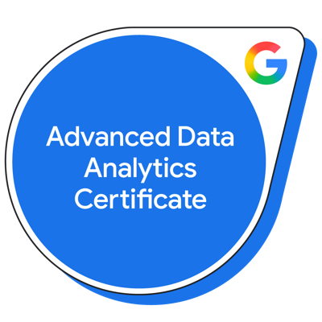
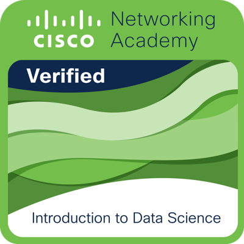
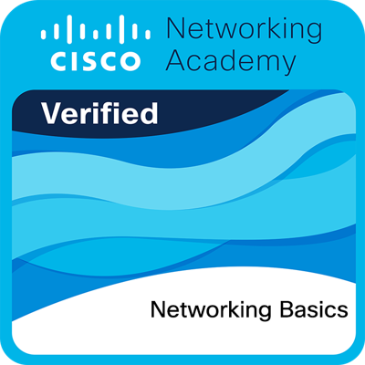

# 👋 Hi, I'm Saman Bepari

### 📊 Aspiring Data Analyst &nbsp;•&nbsp; 🤖 Data Science & Machine Learning &nbsp;•&nbsp; 🔐 Cybersecurity & Networking

---

## 🎖️ Verified Badges

&nbsp;&nbsp;&nbsp;

&nbsp;&nbsp;&nbsp;

Click a badge to jump to its section.

---

## 🧰 Skills Covered by My Certifications

| Area | Skills |
|---|---|
| 📊 **Data Analytics** | Data exploration, statistics, regression analysis, Excel, Power BI, data visualization |
| 🤖 **Data Science / ML** | Machine learning, predictive modeling, R, big data (Hadoop, Spark), NoSQL |
| 🔐 **Cyber & Networking** | Networking fundamentals, IP addressing, cybersecurity essentials, digital security |
| ☁️ **Cloud & AI** | AWS services overview, Databricks, Generative AI |

---

## 🏆 Certifications

> 💡 **Tip:** Click the ▶ arrows to expand a section. Every certificate has a **PDF** link, and most have a **Verify** link or a **Credential ID** you can check with the issuer.

<h3>📊 Data Science & Data Analytics</h3>

 

#### 🌳 Google Advanced Data Analytics Professional Certificate

> The main certificate is the parent. The 7 courses below are the branches that make it up.

| | Certificate / Course | Issued | Credential ID | Links |
|:--|:--|:--|:--|:--|
| 🎓 | **Google Advanced Data Analytics Professional Certificate** (Google · Coursera) | 24 Oct 2026 | `SJDVK7WPCGDW` | [📄 PDF](certificates/data-science-and-analytics/google-advanced-data-analytics/00-google-advanced-data-analytics-professional-certificate.pdf) · [✅ Verify](https://coursera.org/verify/professional-cert/SJDVK7WPCGDW) |
| &nbsp;&nbsp;├── | 1. Foundations of Data Science | 24 Oct 2026 | `M79YAN8VHSNF` | [📄 PDF](certificates/data-science-and-analytics/google-advanced-data-analytics/01-foundations-of-data-science.pdf) · [✅ Verify](https://coursera.org/verify/M79YAN8VHSNF) |
| &nbsp;&nbsp;├── | 2. Go Beyond the Numbers: Translate Data into Insights | 24 Oct 2026 | `CXKYS8XCDDBI` | [📄 PDF](certificates/data-science-and-analytics/google-advanced-data-analytics/02-go-beyond-the-numbers-translate-data-into-insights.pdf) · [✅ Verify](https://coursera.org/verify/CXKYS8XCDDBI) |
| &nbsp;&nbsp;├── | 3. The Power of Statistics | 24 Oct 2026 | `JZ6TG6I8PHOT` | [📄 PDF](certificates/data-science-and-analytics/google-advanced-data-analytics/03-the-power-of-statistics.pdf) · [✅ Verify](https://coursera.org/verify/JZ6TG6I8PHOT) |
| &nbsp;&nbsp;├── | 4. Regression Analysis: Simplify Complex Data Relationships | 24 Oct 2026 | `F145IHGUI329` | [📄 PDF](certificates/data-science-and-analytics/google-advanced-data-analytics/04-regression-analysis.pdf) · [✅ Verify](https://coursera.org/verify/F145IHGUI329) |
| &nbsp;&nbsp;├── | 5. The Nuts and Bolts of Machine Learning | 24 Oct 2026 | `JZBNSM1H8IJC` | [📄 PDF](certificates/data-science-and-analytics/google-advanced-data-analytics/05-the-nuts-and-bolts-of-machine-learning.pdf) · [✅ Verify](https://coursera.org/verify/JZBNSM1H8IJC) |
| &nbsp;&nbsp;├── | 6. Google Advanced Data Analytics Capstone | 24 Oct 2026 | `EPPQMUO1AC1S` | [📄 PDF](certificates/data-science-and-analytics/google-advanced-data-analytics/06-google-advanced-data-analytics-capstone.pdf) · [✅ Verify](https://coursera.org/verify/EPPQMUO1AC1S) |
| &nbsp;&nbsp;└── | 7. Accelerate Your Job Search with AI | 24 Oct 2026 | `T09JYEB2932I` | [📄 PDF](certificates/data-science-and-analytics/google-advanced-data-analytics/07-accelerate-your-job-search-with-ai.pdf) · [✅ Verify](https://coursera.org/verify/T09JYEB2932I) |

 

#### 📈 Other Data Science & Analytics Certificates

| Certificate | Issuer | Issued | Credential ID | Links |
|:--|:--|:--|:--|:--|
| Advanced Data Visualization using Power BI | Microsoft · Great Learning | 04 Nov 2026 | `FFBETEFP` | [📄 PDF](certificates/data-science-and-analytics/great-learning-advanced-data-visualization-power-bi.pdf) · [✅ Verify](https://www.mygreatlearning.com/certificate/FFBETEFP) |
| Master Data Analytics in Excel | Microsoft · Great Learning | 31 Oct 2026 | `TAFWVSMY` | [📄 PDF](certificates/data-science-and-analytics/great-learning-master-data-analytics-in-excel.pdf) · [✅ Verify](https://www.mygreatlearning.com/certificate/TAFWVSMY) |
| Introduction to Data Science | Cisco Networking Academy | 24 Oct 2026 | Verified via QR code on the certificate | [📄 PDF](certificates/data-science-and-analytics/cisco-introduction-to-data-science.pdf) |
| Visualizing Data with R (DV0151EN) | IBM · edX | 26 Apr 2025 | `33d3f05b3dc548499b5a28bf42ee1a77` | [📄 PDF](certificates/data-science-and-analytics/ibm-visualizing-data-with-r.pdf) |
| Big Data, Hadoop, and Spark Basics (BD0225EN) | IBM · edX | 26 Apr 2025 | `1fce95d2d7f44cdfa66ea2488679aea2` | [📄 PDF](certificates/data-science-and-analytics/ibm-big-data-hadoop-spark-basics.pdf) |

<h3>🔐 Cybersecurity & Networking</h3>

 

| Certificate | Issuer | Issued | Credential ID | Links |
|:--|:--|:--|:--|:--|
| Cybersecurity and Digital Security Essentials | Great Learning | 31 Oct 2026 | `JFSXFBVT` | [📄 PDF](certificates/cyber-and-networking/great-learning-cybersecurity-and-digital-security-essentials.pdf) · [✅ Verify](https://www.mygreatlearning.com/certificate/JFSXFBVT) |
| Networking Basics | Cisco Networking Academy | 30 Oct 2026 | `72ff9496-9ccc-4456-ba83-66838fc0d000` | [📄 PDF](certificates/cyber-and-networking/cisco-networking-basics.pdf) |
| IT Fundamentals for Business Professionals: Cybersecurity and Social Implications (ISC101.5x) | UPValenciaX · edX | 25 Apr 2025 | `7802e2d3310a4be784641c7507e7a60d` | [📄 PDF](certificates/cyber-and-networking/upvalenciax-it-fundamentals-cybersecurity.pdf) |

<h3>📚 Other Certifications</h3>

 

| Certificate | Issuer | Issued | Credential ID | Links |
|:--|:--|:--|:--|:--|
| Get Started with Databricks for Generative AI | Databricks · Simplilearn SkillUP | 24 Oct 2026 | `10937401` | [📄 PDF](certificates/other/databricks-generative-ai.pdf) |
| NoSQL Database Basics (DB0151EN) | IBM · edX | 24 Apr 2025 | `ca1fbf98cad346679b557f225dbb4a57` | [📄 PDF](certificates/other/ibm-nosql-database-basics.pdf) |
| AWS Services Overview for IT Professionals (AWS-IT-OVERVIEW) | AWS · edX | 26 Apr 2025 | `7712401d500e4fd09b8a0848f0a06725` | [📄 PDF](certificates/other/aws-services-overview-for-it-professionals.pdf) |

---

⭐ Explore my pinned repositories below for projects &nbsp;|&nbsp; 📅 Last updated: November 2026

<!--
CONTACT SECTION (optional): remove the arrows around this block after you replace the placeholders.

## 📫 Connect With Me
- 💼 LinkedIn: https://www.linkedin.com/in/YOUR-LINKEDIN-USERNAME
- 🌐 Portfolio: https://YOUR-PORTFOLIO-LINK
- 📧 Email: YOUR-EMAIL
-->
